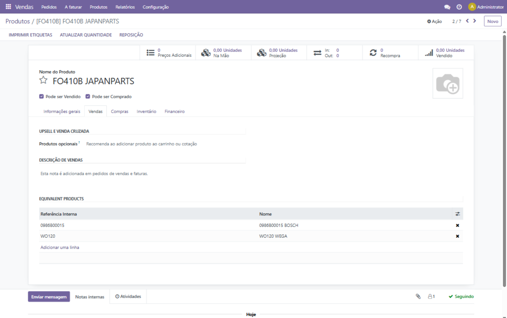
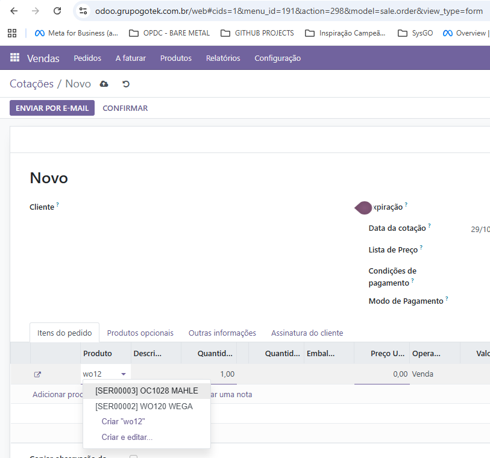

# Product Equivalents

Reusable Odoo addon for managing **direct product equivalents** and surfacing them in the standard product search used by sales orders.

## Português (Brasil)

O **Product Equivalents** permite relacionar produtos substitutos diretamente na ficha do produto. As relações são simétricas: se A é equivalente a B, B também é equivalente a A. Elas não são transitivas: se A equivale a B e B equivale a C, A não passa a equivaler a C automaticamente.

Na cotação ou no pedido de venda, a busca nativa do Odoo continua funcionando e pode apresentar produtos equivalentes diretamente relacionados aos resultados encontrados. O vendedor escolhe qual produto incluir; o módulo não adiciona alternativas automaticamente.

### Como usar

1. Abra o cadastro de um produto.
2. Na aba **Vendas**, use a grade **Produtos equivalentes** para selecionar ou remover relações diretas.
3. Ao pesquisar esse produto em uma linha da cotação ou do pedido de venda, confira as alternativas exibidas no autocomplete.

As equivalências são cadastradas no nível do modelo de produto (`product.template`), portanto as variantes desse modelo podem participar da busca. A grade não cria produtos nem grupos inline. A empresa deve validar se cada relação representa uma substituição tecnicamente adequada.

### Capturas de tela

As capturas foram obtidas no Odoo 16 e ilustram o fluxo de uso também disponível nas branches 17.0, 18.0 e 19.0. A aparência da interface pode variar entre versões.

Grade de equivalências diretas na ficha do produto:



Busca de produtos equivalentes ao preparar uma cotação:



No exemplo, a pesquisa por `wo12` apresenta `WO120 WEGA` e o equivalente `OC1028 MAHLE` no campo **Produto** da linha da cotação. Selecione a alternativa desejada para incluí-la na linha; o módulo não adiciona os dois produtos automaticamente.

### Busca e segurança

- Resultados nativos e equivalentes diretos são ordenados pela aderência do nome e da referência ao texto pesquisado; resultados nativos prevalecem em caso de empate.
- A expansão considera somente relações diretas dos resultados nativos; não percorre relações em cadeia.
- Domínios da busca, como disponibilidade para venda e empresa, continuam aplicados.
- A visibilidade dos produtos segue as regras de acesso e de empresa do Odoo.
- O limite do autocomplete continua valendo.

### Atualização de grupos legados

Na atualização para a versão `18.0.2.0.0`, grupos legados ativos com exatamente dois produtos compatíveis são convertidos em uma relação direta. Grupos ativos com mais de dois produtos ou com produtos de empresas específicas diferentes interrompem a atualização para evitar a criação automática de combinações ambíguas. Grupos legados são mantidos para auditoria.

## English

Product Equivalents adds manually maintained, direct product-to-product relationships to product templates and includes directly related products in Odoo's standard Sales Order product search. The relationship is symmetric and non-transitive: A ↔ B and B ↔ C do not imply A ↔ C. Native matches and direct equivalents are ranked together by text relevance, with native matches winning ties. Caller domains and access rules are respected, and the salesperson chooses which product to add.

## Installation

Place `product_equivalent` in an Odoo addons directory, update the Apps list, and install **Product Equivalents**.

```bash
./odoo-bin -d DATABASE -i product_equivalent --stop-after-init
```

To upgrade an existing installation:

```bash
./odoo-bin -d DATABASE -u product_equivalent --stop-after-init
```

## Compatibility

This branch targets Odoo 18.0. See the corresponding version branch for other supported Odoo releases.

## License

LGPL-3.
